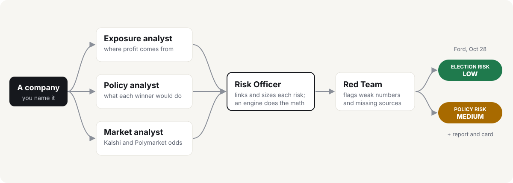
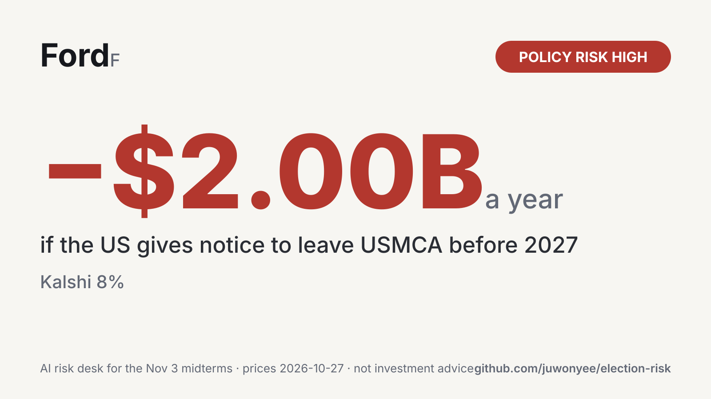

# election-risk

**An AI risk desk for what the Nov 3, 2026 US elections could do to a company's profit.**

Name a company. Your coding agent staffs a desk: analysts map how the company makes its profit, what each
candidate would do, and every Kalshi and Polymarket market that can move it. A Risk Officer sizes each risk
with a small engine, a Red Team flags the weak numbers, and every run ends in two verdicts, with sources.
Works in Claude Code, Codex, Cursor, Gemini and any agent that reads [Agent Skills](https://agentskills.io).

**See it without installing:** live reports for [Ford](https://juwonyee.github.io/election-risk/examples/F/report.html), [PG&E](https://juwonyee.github.io/election-risk/examples/PCG/report.html),
[Coinbase](https://juwonyee.github.io/election-risk/examples/COIN/report.html) and [DraftKings](https://juwonyee.github.io/election-risk/examples/DKNG/report.html).

<p align="center"></p>

## Try it

Install it (one line, [below](#install)), then ask your agent:

```text
What does Nov 3 mean for Ford?
```

## What you get

The desk board, in the chat and at the top of a local web report ([Ford's](https://juwonyee.github.io/election-risk/examples/F/report.html), prices of Nov 1):

| Analyst | Signal | Why |
|---|---|---|
| Exposure | EXPOSED | biggest if it happens: −$1.30B a year (−19.2% of profit) |
| Policy | WEAK LINK | for results of 1% of profit or more, who wins moves the chance by 5 points at most |
| Market | PRICED | 3 markets on Kalshi and Polymarket |
| Red Team | CAUTION | 8 flags to read |

**Risk Officer:** Election risk **LOW** · Policy risk **MEDIUM**

- **Election risk LOW:** nothing passes the bar. The biggest is +$1.00B a year if Congress repeals the
  Section 232 auto and metals tariffs, but only 5% even if Democrats win.
- **Policy risk MEDIUM:** Kalshi puts 5% on the US giving notice to leave USMCA before 2027. For Ford:
  −$1.30B a year (−19.2% of profit).
- **Red Team:** the USMCA impact is an estimate, and at the high end of its range (−$2.50B) policy risk would
  be HIGH.

And a card to share (the report saves it as PNG):

<p align="center"></p>

## What it found (prices of Nov 1, 2026)

Eight household names, run end to end (research Oct 27–28, prices refreshed Nov 1). Each links to its full
summary, profit structure and sources.

| Company | Election risk | Policy risk | Biggest risk | Market | Profit, per year |
|---|---|---|---|---|---|
| [PG&E](examples/PCG/summary.md) | **High** | none | Becerra wins (97%) → 30% chance of a rate freeze, vs 0% under Hilton | Kalshi | **−$600M** (−12.6%) |
| [DraftKings](examples/DKNG/summary.md) | Medium | **High** | Congress bans sports contracts on prediction markets in 2026 | Polymarket 18% | **+$150M** (+24.2%) |
| [Coinbase](examples/COIN/summary.md) | Low | **High** | Clarity Act (crypto market structure) becomes law before 2028 | Kalshi 28% | **+$370M** (+25.8%) |
| [Ford](examples/F/summary.md) | Low | Medium | US gives notice to leave USMCA before 2027 | Kalshi 5% | **−$1.3B** (−19.2%) |
| [GM](examples/GM/summary.md) | Low | Medium | Same USMCA notice | Kalshi 5% | **−$1.7B** (−13.3%) |
| [Disney](examples/DIS/summary.md) | none | Medium | Federal film and TV production tax credit becomes law | Kalshi 28% | **+$400M** (+2.3%) |
| [Uber](examples/UBER/summary.md) | Low | none | California AG suit ends in a Lyft-sized settlement: 70%, and who wins moves it at most 11 points | Kalshi | **−$170M** (−3.1%) |
| [Starbucks](examples/SBUX/summary.md) | Low | Low | New York City enacts a $30 minimum wage by 2030 | Kalshi 7% | **−$60M** (−2.0%) |

"none" means no market was linked to the company on that side.

**The surprise: who wins on Nov 3 moves these odds less than the headlines suggest.** Only one of the eight
gets a high election risk. The bigger risks come from markets that price the policy directly and barely
depend on the vote: the Clarity Act and sports contracts (high), USMCA for Ford and GM (medium). Where the
election does matter, the Red Team keeps it honest: research finds a new utility commission moves allowed
returns by about 0.15 points, and attorneys general of both parties sue companies, so PG&E and Uber carry
those flags.

> **Not investment advice.** Analyst drafts for human review. No recommendation to buy, sell or hold any
> security or to trade any contract. Markets are shown as information only.

## How it works

Four skills, one per desk role. Each works on its own; `election-risk` calls the other three by name.

| Role | Skill | Ask it on its own |
|---|---|---|
| Exposure analyst | **profit-structure** | "Which of Ford's profit lines can a government move?" |
| Policy analyst | **candidate-positions** | "What would California's next governor do on electricity rates?" |
| Market analyst | **prediction-markets** | "What are the odds on a data-center moratorium?" |
| Risk Officer + Red Team | **election-risk** | "What does Nov 3 mean for Uber?" |

- **The agent researches, the engine calculates.** Every number comes from a small Python engine (standard
  library only), not from the model's arithmetic.
- **Two kinds of market.** *Direct*: the market resolving Yes is the policy, so its price is the chance.
  *Race*: the market prices who wins, times the chance the policy follows each winner.
- **Two verdicts.** *Election risk* = share of profit × how much who wins moves the chance. *Policy risk* =
  share of profit × the market's chance. High at 2% of profit or more, Medium at 0.5%. Only results that pass
  the bar count (at least 1% of profit, volume 10,000, chance 5%); when none does, the board says what came
  closest and why it falls short.
- **Every impact shows how it was built**: the formula with each number and its source, and a low-high range.
- **Red Team.** It checks whether each verdict survives its own range: "Policy risk HIGH ... would be LOW at
  the low end" means the verdict rests on one estimate. It also flags positions with no source link (counted
  as 0), thin markets and estimated impacts.

## Install

**Ask your agent** (recommended):

```text
Install election-risk from https://github.com/juwonyee/election-risk
```

<details>
<summary>Or install it yourself</summary>

```bash
# Claude Code
claude plugin marketplace add juwonyee/election-risk
claude plugin install election-risk@election-risk

# Codex
codex plugin marketplace add juwonyee/election-risk
codex plugin add election-risk@election-risk

# Gemini
gemini extensions install https://github.com/juwonyee/election-risk

# Cursor
git clone --depth 1 https://github.com/juwonyee/election-risk ~/.cursor/plugins/local/election-risk

# Any other agent, via the skills CLI
npx skills add juwonyee/election-risk
```

Install the plugin or the skills, not both (you would see every skill twice).
</details>

Needs Python 3.10+. No packages, no API keys.

## First run: the policy book

Race results need to know what each candidate would actually do. That lives in a **policy book**: one file
per Nov 3 contest, every position with a source link, and the chance it happens if they win, from a
[research-based probability table](skills/candidate-positions/references/probability-table.md)
(veto override rates, governors' proposal success, ballot measure pass rates and more).

The book is not in this repo, on purpose: candidate positions in a public repo could be edited by anyone.
On the first run your agent asks you to pick:

- **Build it yourself**: your agent researches every contest with sources. It takes a while, and it's reused
  for every company afterwards.
- **Download ours**: ready in a minute, built by us on the date shown, possibly out of date. Your agent tells
  you that and asks before running `erisk book download --accept-risk`.

Every report prints which book it used (built or downloaded, date, fingerprint) and when prices were fetched.

## Limits

- **Chances are upper bounds.** The probability table comes from historical rates over a full term, used here
  for about two years.
- **Impacts are often estimates.** Each one is labeled verified or estimated and shows its formula, so you can
  check it.
- **The book can be wrong or out of date.** Positions with no source count as 0, and the agent lists rows it
  doubts as weak links.
- **Only priced risks.** A risk with no Kalshi or Polymarket market is left out. Unreachable sources are
  listed, never worked around.
- **Prices move.** The examples use Nov 1 prices. Raw price snapshots are not kept in this repo (venue terms).

It won't recommend trades, size positions, help open market accounts, or work around a venue's regional
restrictions. It names no small businesses (franchised chains are discussed as "a typical store").

## Run the engine yourself

```bash
python3 engine/erisk.py markets pull                         # every open Nov 3 + policy market
python3 engine/erisk.py book status                          # policy book coverage
python3 engine/erisk.py book find --tag utilities --state CA
python3 engine/erisk.py markets show GOVPARTYGA-26 --venue kalshi
ERISK_OUT=examples python3 engine/erisk.py compute --company SO --no-open   # test fixture, synthetic prices
```

## Develop

See [AGENTS.md](AGENTS.md). Edit `engine/`, then `python3 scripts/sync_engine.py`; check with
`python3 scripts/validate_skills.py` and `python3 -m unittest discover tests`.

## License

MIT.
